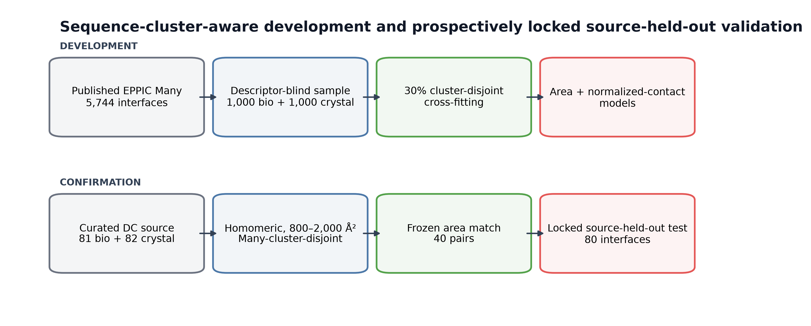
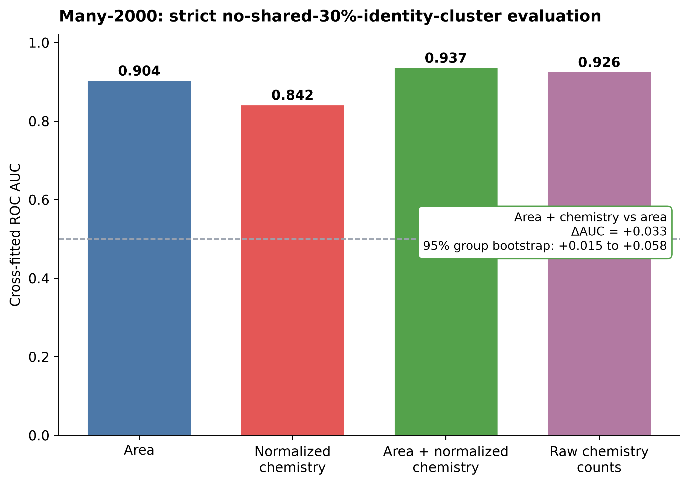
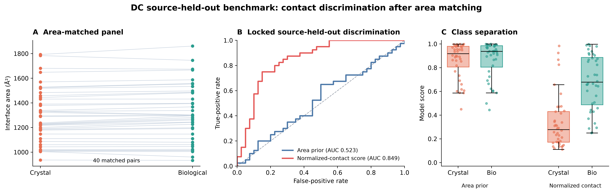

# When interface size misleads: an area-matched, sequence-cluster-disjoint benchmark for biological-versus-crystal interface classification

**Olga Lavinda**

Department of Chemistry and Biochemistry, Stern College for Women, Yeshiva University, New York, NY 10016, USA

Correspondence: olga.lavinda@yu.edu · ORCID: 0000-0003-3577-5984

## Abstract

Benchmarking biological-versus-crystal interface classification is confounded by interface area and
related structures shared across evaluation sets. We constructed a descriptor-blind,
sequence-cluster-aware development panel and a locked, source-held-out benchmark for the regime in
which area is uninformative. The development panel contained 2,000 balanced BioMany/XtalMany
interfaces, one per PDB entry; connected components of RCSB 30%-sequence-identity clusters remained
within folds. Area alone achieved ROC AUC 0.904. Adding five contact-derived descriptors increased
AUC to 0.937 (difference 0.033; group-bootstrap 95% interval 0.015–0.058). We then froze 40
homomeric biological and 40 homomeric crystal interfaces from the curated Duarte–Capitani source in
the prespecified 800–2000 Ų ambiguity band, matched on area and sharing no 30%-identity cluster
with development. Area produced AUC 0.523, as intended by design. The frozen normalized-contact
score reached AUC 0.849 (dependency-component bootstrap 95% interval 0.751–0.927) and average
precision 0.812; its AUC difference from area was 0.326 (0.218–0.406), meeting the success rule.
Post hoc, unchanged PRODIGY-cryst reached AUC 0.847; the normalized-contact-minus-PRODIGY difference
was 0.0019 (−0.102 to 0.109). The benchmark establishes that contact-based discrimination survives
explicit area control and sequence-cluster separation. The five-feature score serves as a frozen,
transparent demonstration rather than a new performance frontier.

**Keywords:** protein–protein interface; crystal contact; biological assembly; interface area;
hydrophobic contacts; source-held-out validation; sequence-cluster separation

## Introduction

Protein crystals contain contacts required by the physiological assembly and contacts created by
lattice packing. Distinguishing the two classes requires evidence beyond crystallographic symmetry;
accurate classification protects biological-assembly annotation, mechanistic interpretation, docking
assessment, and interface design [1–5]. Widely used methods approach the problem from complementary
directions. PISA estimates interface stability and assembly energetics [2], whereas EPPIC combines
interface geometry with evolutionary conservation [3–5]. Other classifiers use composition,
surface complementarity, atomic or residue contacts, covariation, and machine learning [6–12].

Interface area is an unusually strong baseline. Biological contacts are generally larger than
lattice contacts, and area alone can classify conventional benchmarks well [1,3–5]. That baseline
also creates a methodological problem. A model can appear accurate because labels and interface
areas differ, even if its additional physicochemical terms contribute little. Conversely, the
important cases are often those in which size is ambiguous: small biological interfaces and large
crystal contacts. Duarte and colleagues estimated that both types are frequent between
approximately 800 and 2000 Ų and deliberately curated the DCbio and DCxtal datasets within that
overlap [3].

Prior work establishes contact chemistry as a useful signal. Elez, Bonvin, and Vangone trained
contact- and energetics-based classifiers on the Many datasets and found that apolar–apolar
contacts were particularly discriminative [6]. More elaborate methods have used physicochemical
surface complementarity, coevolution, or many molecular descriptors [7–12], and Many-trained
contact and deep-learning models have used DC as a held-out test [6,11,12]. More recently,
ProInterVal trained learned interface representations on Many and evaluated them on a similar-area
DC panel, while a community-wide study evaluated 252 scores from 13 groups on 1,677
area-challenging homodimers [19,20]. These studies establish area-controlled interface
classification as an active benchmark problem and focus the open evaluation question addressed
here: does a small, transparent set of local contact descriptors add information beyond area under
strict 30%-identity sequence-cluster separation, and what performance survives when the DC test is
explicitly area matched?

We addressed that question in two stages (Figure 1). First, we evaluated area and lightweight
chemistry on a frozen 2,000-interface subset of BioMany/XtalMany, using connected 30%-identity
sequence-cluster components for cross-validation. Second, after hard-case analyses motivated an
area-prior/secondary-chemistry hypothesis, we froze an area-matched homomeric DC panel before computing
its contact descriptors. This design separates broad development evidence from a single locked,
source-held-out test and places the principal claim in the regime where area is expected to fail.

**Figure 1. Sequence-cluster-aware development and prospectively locked source-held-out
validation.** The Many-2000 development panel used descriptor-blind selection and was evaluated using
connected components of RCSB 30%-identity chain clusters. DC confirmation was restricted to
homomers in the 800–2000 Ų overlap band, purged of Many-related clusters, matched on area, and frozen before
chemistry computation.

## Methods

### Source datasets and exact interface provenance

BioMany and XtalMany were obtained from the preserved public EPPIC dataset repository. BioMany was
constructed from interfaces recurring across different crystal forms in ProtCID and from crystal
structures corresponding to NMR-validated dimers. XtalMany comprises homomeric contacts produced by
translations or screw axes that imply non-closed assemblies [4]. At preserved repository commit
`8f0b00f2a82d3f796219f9ba41dc64acf13bd65f`, the active files contain 2,831 biological and
2,913 crystal interfaces across 5,370 PDB entries [18]. Each record includes a PDB identifier and
EPPIC interface serial.

DCbio and DCxtal originate from manual experimental curation of small biological interfaces and
large crystal contacts [3]. We used the source labels in the maintained repository files. The DC
supplementary convention specifies the largest
interface in a crystal; accordingly, a plain PDB row maps to EPPIC interface serial 1, while any
following integers enumerate additional labelled interfaces. Expanding the current active files
produced 81 biological and 82 crystal interfaces. All 163 were resolved through the EPPIC REST
interface metadata to an exact chain pair and crystallographic operator. Current EPPIC predictions,
scores, and confidence values served as provenance-audit fields. Model inputs came exclusively from
interface area and the contact-derived quantities defined below.

### Descriptor-blind Many-2000 panel

Selection occurred before descriptor calculation. We removed 14 PDB entries shared with DC and 61
PDB entries carrying mixed Many labels. We sampled 1,000 PDB entries per class with seed 20260722
and retained the lowest-serial labelled interface per sampled entry. A class-balanced reserve of
100 entries per class was frozen simultaneously. Twenty-eight metadata-resolution failures and ten
coordinate/descriptor failures were replaced by the next unused reserve entry of the same class.
The frozen reserve order governed every replacement. The final panel contained 2,000
interfaces from 2,000 PDB entries. Its interface-key SHA256 is
`2596b176f2590bde4286e88c4e41b4c8ecd7664a29179bb4268b4d23d864477b`.

### Interface coordinates and descriptors

For each published interface serial, we downloaded the exact transformed two-partner mmCIF from
EPPIC. Protein atoms were identified from standard amino-acid residue names. The size baseline was
the one-sided EPPIC interface area in Ų. We counted cross-interface atom pairs within 4.0 Šand
computed four additional local quantities: selected polar side-chain N/O/S atom pairs at 2.5–3.5 Å,
opposite-charge side-chain atom pairs within 4.0 Å, carbon–carbon atom pairs within 4.0 Å between
ALA, VAL, ILE, LEU, MET, PHE, TRP, PRO, or TYR residues, and a charge-pair balance proxy. The
charge-pair balance proxy (stored as `elec_complementarity` in the analysis tables) was

**CB = (N_opposite - N_like)/(N_opposite + N_like),**

for side-chain atom pairs assigned opposite or like formal signs within 6.0 Å. A value of +1
indicates exclusively opposite-sign pairs and −1 exclusively like-sign pairs. Total contact,
polar-pair, opposite-charge-pair, and designated-hydrophobic-residue carbon-pair counts were
normalized per 100 Ų of interface area; the charge-pair balance remained a dimensionless ratio.
These reproducible geometric atom-pair proxies use fixed element, residue, atom-name, distance, and
formal-sign rules. The polar proxy counts selected side-chain N/O/S proximity, and the charge proxy
uses fixed formal signs, including positive assignments for histidine Nδ1 and Nε2.

### RCSB sequence-cluster grouping

We retrieved polymer-entity membership through the RCSB PDB Data API GraphQL endpoint
(`https://data.rcsb.org/graphql`) on July 22, 2026, using official MMseqs2 sequence-identity groups
at the 30% cutoff [14,15]. All 2,000 Many interfaces mapped successfully, representing 1,574 chain clusters and
1,556 unordered chain-cluster pairs. For the strict grouping, we constructed a graph in which two
sequence clusters were connected if they appeared as partners in any interface. Each connected
component was assigned wholly to one fold, placing every interface involving a given partner cluster
in the same fold.
This produced 1,509 components; the largest contained 42 interfaces (2.1%).

### Development models and cross-validation

All models were balanced logistic regressions implemented with scikit-learn [16]. Missing values
were median-imputed from the training fold, features were standardized from the training fold, and
the logistic regression used L2 regularization with C=1.0. Four prespecified representations were
evaluated:

1. **area only:** interface area;
2. **normalized chemistry only:** total contact, polar-pair, opposite-charge-pair, and hydrophobic
   carbon-pair densities plus the charge-pair balance proxy;
3. **area plus normalized chemistry:** the union of the preceding features; and
4. **raw chemistry only:** unnormalized atom-pair counts plus the charge-pair balance proxy.

We used five-fold StratifiedGroupKFold cross-validation, repeated ten times with seeds derived from
20260722. Predictions for each interface were averaged over repeats before calculation of the
headline ROC AUC. Paired uncertainty for AUC differences was estimated by 5,000 bootstrap samples
of strict sequence-cluster components. This bootstrap resampled the fixed averaged cross-fitted
predictions and quantifies grouped prediction uncertainty conditional on those scores.

### Hard-case hypothesis development

We explicitly distinguish hypothesis development from source-held-out confirmation. Among 181 Many-2000
interfaces whose published label disagreed with the current EPPIC call, area was inversely ranked
(post hoc AUC 0.434), whereas normalized chemistry reached 0.676. A subsequent SHA256-selected,
30%-identity-cluster-disjoint internal challenge contained 107 difficult interfaces from 66
components and had zero component overlap with 1,865 development rows. The chemistry-only logistic
pipeline was pre-existing but absent from the first locked report. The audit ledger records its
calculation two minutes after the challenge was opened, establishing its post-opening status; it
reached AUC 0.832. The 66 withheld components contained 135 total rows, of which 107
met the difficult-case definition, explaining why the subsequent DC models were trained on
2,000 − 135 = 1,865 rows. The challenge contained 55 heteromeric biological interfaces, zero
heteromeric crystal controls, and nine biological positives in its homomeric subset. We therefore
classified it as spent, nonconfirmatory evidence whose role was limited to motivating the two-score
hypothesis tested on DC. Model development ended before the DC evaluation.

### Prospective DC panel lock

The source-held-out panel was frozen before downloading DC interface coordinates or calculating
contact descriptors. Homomers were defined by equality of the two RCSB polymer entities. We removed any
interface whose PDB entry or either 30%-identity partner cluster appeared anywhere in Many-2000,
then restricted the candidates to the literature-defined 800–2000 Ų ambiguity band. The remaining
52 biological and 64 crystal interfaces were matched one-to-one by maximum-cardinality ordered
assignment within an absolute log-area caliper of 0.05, followed by minimum total log-area
distance. This yielded 40 biological/crystal pairs: 80 interfaces from 75 PDB entries and 72
30%-identity sequence clusters.

Mean areas were 1,309 Ų for biological and 1,297 Ų for crystal interfaces; the standardized mean
difference was 0.055. Median within-pair absolute log-area difference was 0.0108 and the maximum
was 0.0464. The frozen panel SHA256 is
`e17c28404c2b4bd187077ab1b1aba7d0338476eb0df1e6f4db1e4e63b05f1885`.

### Locked source-held-out models and inference

The source-held-out comparison used separate area-only and normalized-contact logistic
regressions. The locked pipelines used training-median imputation with missingness indicators,
training-set standardization, balanced logistic regression, and C=1.0. Both were fitted exclusively to the
1,865-row Many development partition. All imputation, scaling, fitting, feature specification,
calibration policy, and threshold policy were fixed from Many before the DC panel was opened. The
charge-pair balance proxy was undefined for 83
development interfaces and one DC interface because no charged pair fell within the cutoff; these
values were handled by the locked imputation-and-indicator pipeline.

The primary statistic was chemistry-minus-area ROC AUC on all 80 frozen interfaces. The
prospective success rule required chemistry AUC of at least 0.65 and a lower 95% bootstrap bound for
the AUC difference above zero. Bootstrap units were connected components joining records that
shared either a matched pair or a 30%-identity sequence cluster, leaving 32 dependency components. We drew
20,000 component bootstrap samples. Average precision and Brier score were secondary descriptive
metrics. The model specification was fixed before this evaluation. Subsequent exact reruns reproduce
the fixed evaluation.

### Post hoc published-classifier comparison

After opening the locked result, we evaluated PRODIGY-cryst as a published, standalone contact
classifier distributed with an unchanged pretrained implementation. We used the official
`haddocking/interface-classifier` repository at commit
`29d99d535cae3014608c9394b8809619a60fcfa2`; the serialized model SHA256 was
`b0bea87d845b37a83431767aa7f03bc46d2620d8caabc1195a67132f38e0a26f`. The
unchanged feature order and random-forest nodes were applied to the exact 80-interface panel using
Biopython 1.85 mmCIF parsing, label-asym chain identifiers, standard amino acids, non-hydrogen
atoms, and the classifier's effective 5.0-Å residue-contact cutoff. The bundled 1PPE example served
as a compatibility control.

### Post hoc family/domain-overlap sensitivity

After the locked evaluation, we retrieved CATH, ECOD, Pfam, and SCOP annotations for both partners
in every DC interface from the RCSB PDB Data API. For each DC interface separately, we removed from
the 1,865-row development partition every Many interface sharing at least one recorded annotation
token with either DC partner. We then refitted the unchanged normalized-contact pipeline on the
retained rows and scored that DC interface. All 80 DC interfaces had at least one recorded
family/domain annotation. The sensitivity analysis retained a median of 1,851 development
interfaces per refit (range 1,644–1,865). We compared the resulting 80 row-specific sensitivity
scores with the original locked scores using the same 20,000-sample dependency-component
bootstrap. This analysis was post hoc; the immutable locked predictions remained primary.

## Results

### Area dominates broad classification; normalized contacts add a reproducible increment

Under strict no-shared-30%-identity-cluster cross-validation, area alone achieved AUC 0.904 (Figure 2;
Table 1). Normalized chemistry without area was weaker at 0.842. Combining area and normalized
chemistry increased AUC to 0.937, a gain of 0.0328 over area alone. The paired component-bootstrap
interval was 0.0148–0.0581, and none of 5,000 bootstrap deltas was at or below zero. Raw chemical
counts reached AUC 0.926; because raw counts grow with interface size, this representation partly
reintroduced the area signal.

Contact-derived information supplied a statistically supported increment in broad
sequence-cluster-aware evaluation. Its absolute magnitude was modest relative to the already strong
area baseline.

**Figure 2. Many-2000 strict no-shared-30%-identity-cluster evaluation.** Cross-fitted ROC AUC for area,
normalized chemistry, their combination, and raw chemical counts. The inset gives the paired
component-bootstrap difference between area plus normalized chemistry and area alone.

### The broad incremental signal is primarily hydrophobic-contact density

A post hoc strict-group ablation showed that area plus hydrophobic-contact density achieved AUC
0.9371, essentially identical to the full area-plus-chemistry model (0.9370). Removing hydrophobic
density reduced AUC to 0.9083. Contact density alone added 0.0024 to area; the charge-pair balance
proxy added 0.0032; polar-pair and opposite-charge-pair densities produced small negative deltas.
These analyses were performed after the broad comparison and are hypothesis-generating. Together,
they support a one-dominant-descriptor interpretation: carbon-pair density among residues designated
hydrophobic supplies the principal broad increment, consistent with previous contact-based analysis
of BioMany/XtalMany [6].

### Area matching removed the dominant size shortcut from the source-held-out test

All 80 frozen DC interfaces produced successful coordinate and descriptor records. The panel was
balanced 40/40 and closely area-matched (Figure 3A). PDB-entry and 30%-identity-cluster separation
from Many-2000 was complete. The remaining dependencies—multiple interfaces from five PDB entries,
repeated 30%-identity clusters, and the matched-pair design—were incorporated into the 32-component
bootstrap.

The area-only model assigned generally high biological-class scores to both DC classes (Figure
3C), reflecting how the 800–2000 Ų restriction selected interfaces that are difficult for the
broad size prior. As intended by the panel design, area AUC was 0.523 (bootstrap interval
0.502–0.556), confirming near-random ranking as the panel-construction check (Figure 3B). Its
average precision was 0.538 and Brier score 0.405. The prespecified contact score provides the
substantive locked result in that controlled regime.

### Frozen normalized contact chemistry transferred to the source-held-out ambiguity regime

The normalized-contact score achieved ROC AUC 0.849 on the locked DC panel (bootstrap interval
0.751–0.927), average precision 0.812, and Brier score 0.162 (Figure 3B–C; Table 1). The primary AUC
difference relative to area was +0.326. Its dependency-component bootstrap interval was +0.218 to
+0.406; none of 20,000 replicates had a difference at or below zero. The prespecified success rule
was therefore met.

This result comes from the separately curated DC source. Its exact interfaces were adjudicated
before analysis, Many-related 30%-identity clusters were excluded, and the matched panel and success
rule were frozen before contact descriptors were computed. The experiment therefore confirms
transfer of the fixed representation to the specific homomeric, area-ambiguous regime for which it
was designed.

**Figure 3. Locked DC source-held-out validation.** (A) Published EPPIC areas for 40 matched
biological/crystal pairs. (B) ROC curves for the frozen area-prior and normalized-contact scores.
(C) Model scores by class. The complete panel lock preceded feature
calculation and model evaluation.

### Post hoc interpretation identifies one dominant signal

After opening the locked result, we examined each DC descriptor separately and inspected the frozen
model coefficients. These analyses are classified as post hoc interpretation outside the success
rule. Designated-hydrophobic-residue carbon-pair density alone reached AUC 0.829, compared with
0.849 for the full frozen score; the charge-pair balance proxy reached AUC 0.740. Total-contact,
polar-pair, and opposite-charge-pair densities were individually near chance (AUC 0.504, 0.428, and
0.488, respectively). In the frozen standardized logistic model, the hydrophobic-density
coefficient was 1.704; the other five coefficients, including the missingness indicator, ranged
from 0.072 to 0.153 (Table 3). The five-feature score therefore has a one-dominant-descriptor
interpretation: designated-hydrophobic-residue carbon-pair density supplies the primary signal, with
small contributions from the remaining proxies. The five-feature specification was frozen before
the panel opened. Replacing it with the single dominant descriptor would now be post hoc model
selection, so the full score remains the demonstration vehicle and the univariate result remains
interpretive.

### An unchanged published contact classifier performs similarly on the exact panel

We next evaluated the unchanged PRODIGY-cryst random-forest classifier [17] on the same 80
interfaces as an explicitly post hoc comparator. Its official bundled 1PPE example was reproduced
exactly before panel evaluation (71 residue contacts; biological probability 0.804). PRODIGY-cryst
reached AUC 0.847 and average precision 0.859, compared with 0.849 and 0.812 for the normalized-
contact score. The AUC difference was 0.0019 (20,000-sample dependency-component bootstrap interval
−0.102 to 0.109), and the score correlation was 0.562. The similar AUC point estimates and broad
interval support the benchmark interpretation: established and lightweight contact signals both
remain useful after explicit area matching and 30%-identity-cluster purging. Their secondary metrics
and individual rankings differ.

### Performance is stable after recorded family/domain purging

The row-specific family/domain-purged refits reached AUC 0.848 on the 80 annotated DC interfaces,
compared with 0.849 for the original locked score. The AUC difference was −0.0019
(20,000-sample dependency-component bootstrap interval −0.0069 to +0.0024). This post hoc
sensitivity supports stability to recorded CATH, ECOD, Pfam, and SCOP overlap while preserving the
original locked result as the primary analysis. Its scope is limited to recorded annotations;
unannotated remote relationships may remain.

## Discussion

The study contributes a locked, area-matched and sequence-cluster-separated benchmark for the
regime in which interface size loses discrimination. Across Many-2000, area is an excellent
baseline and local normalized chemistry adds about 0.03 AUC. Within the source-held-out overlap
panel, area loses discrimination and contact features separate the classes strongly. A descriptor
can therefore be secondary in the overall population and useful where the dominant prior is
deliberately controlled.

This supports a two-score interpretation. Interface area provides the general structural prior; in
the 800–2000 Ų homomeric overlap band, normalized contacts provide a separately validated secondary
score. Separate reporting preserves the study's evaluation design and keeps deployment calibration
for a future prevalence-representative cohort.

Evaluation control and regime definition are the durable contributions. The dominance of
hydrophobic-contact density replicates the biological pattern reported by Elez and colleagues on
related Many data [6]. Previous work on the same sources achieved strong Many-trained/DC-tested
classification from residue contacts and deep representations [6,11,12], and unchanged
PRODIGY-cryst produced a similar AUC point estimate on the exact panel.
ProInterVal reports accuracy on a different DC composition, and the community study reports AUC on
its separately constructed 1,677-homodimer benchmark [19,20]. Those values answer related benchmark
questions and are not direct performance comparators for the present AUC. The locked
baseline-controlled transfer design localizes the incremental signal to hydrophobic contact
density.
An explicit area baseline, strict no-shared-30%-identity-cluster cross-validation, and a
prospectively frozen, closely area-matched source-held-out panel reveal both the area shortcut and
the regime in which a lightweight contact score retains value.

The frozen five-feature score adds transparency, an explicit one-dominant-descriptor
interpretation and prospective specification before the panel was opened. The post hoc
PRODIGY-cryst result shows that an established contact classifier also transfers to the benchmark;
it was not part of the locked success rule.

The inference is scoped to homomeric biological-versus-crystal interfaces in the 800–2000 Ų
overlap band. DC's historical role in EPPIC development makes current EPPIC calls provenance-audit
fields on this panel. The DCbio/DCxtal labels were manually curated by the group that developed
EPPIC [3], so benchmark composition may favor cases resolvable by contact or evolutionary evidence.
Labels, areas and transformed interfaces derive from the curated EPPIC system, whereas the model
features use the fixed geometric atom-pair definitions reported in Methods.

The broad bootstrap interval conditions on fixed cross-fitted predictions. Residual remote
homology, domain, and fold relationships may remain after 30%-identity clustering. The post hoc
family/domain-purged refits preserved the AUC point estimate after removing recorded CATH, ECOD,
Pfam, and SCOP overlap on a row-specific basis. The current comparator analysis covers one
published standalone contact classifier. Together, these boundaries define the evidence for the
homomeric, area-overlap benchmark regime.

## Conclusions

The locked benchmark establishes a controlled regime for biological-versus-crystal interface
classification: area is uninformative by design, development and test share no 30%-identity
sequence cluster, and contact-based discrimination remains strong. A prospectively frozen,
five-feature score reached AUC 0.849, while post hoc unchanged PRODIGY-cryst reached 0.847. The
dominant hydrophobic-contact signal replicates earlier work; the new result is its persistence under
explicit area control, source separation and prospective panel locking.

## Tables

**Table 1. Development and locked source-held-out performance.**

| Stage | Model | n | ROC AUC | Average precision | Brier | Relevant AUC contrast (95% interval) |
|---|---|---:|---:|---:|---:|---:|
| Many strict sequence-cluster cross-fitting | Area | 2,000 | 0.904 | — | — | reference |
| Many strict sequence-cluster cross-fitting | Normalized chemistry | 2,000 | 0.842 | — | — | vs area: −0.062 (−0.100, −0.016) |
| Many strict sequence-cluster cross-fitting | Area + normalized chemistry | 2,000 | 0.937 | — | — | vs area: +0.033 (+0.015, +0.058) |
| Many strict sequence-cluster cross-fitting | Raw chemistry counts | 2,000 | 0.926 | — | — | vs area: +0.022 (−0.002, +0.051) |
| DC locked source-held-out validation | Area prior | 80 | 0.523 | 0.538 | 0.405 | reference |
| DC locked source-held-out validation | Normalized contact chemistry | 80 | **0.849** | **0.812** | **0.162** | **vs area: +0.326 (+0.218, +0.406)** |
| DC post hoc same-panel comparison | PRODIGY-cryst | 80 | 0.847 | 0.859 | 0.222 | normalized contact minus PRODIGY: +0.0019 (−0.102, +0.109); post hoc |

The PRODIGY-cryst row is a post hoc comparison calculated after the locked result was opened.

**Table 2. DC panel accounting before area matching.**

| Quantity | Value |
|---|---:|
| Input interfaces | 163 |
| Excluded as heteromeric | 9 |
| Excluded for Many 30%-identity-cluster overlap or missing cluster mapping | 35 |
| Excluded outside the 800–2000 Ų ambiguity band | 3 |
| Eligible biological interfaces | 52 |
| Eligible crystal interfaces | 64 |
| Frozen matched pairs | 40 |
| Frozen unique PDB entries | 75 |
| Frozen unique 30%-identity sequence clusters | 72 |
| Area standardized mean difference | 0.055 |

**Table 3. Frozen normalized-contact model parameters and post hoc DC univariate AUCs.**

| Feature | Training median | Training scale | Standardized coefficient | DC univariate AUC |
|---|---:|---:|---:|---:|
| Total atom-pair density | 13.057 | 8.493 | 0.079 | 0.504 |
| Selected polar side-chain atom-pair density | 0.189 | 0.230 | 0.153 | 0.428 |
| Opposite-charge side-chain atom-pair density | 0.324 | 0.403 | 0.092 | 0.488 |
| Hydrophobic carbon-pair density | 1.084 | 1.097 | **1.704** | **0.829** |
| Charge-pair balance proxy | 0.333 | 0.498 | 0.110 | 0.740 |
| Charge-pair-balance missingness indicator | — | 0.206 | 0.072 | — |

The intercept was 0.147. Medians and scales were estimated from the 1,865-row development
partition. Univariate DC AUCs are post hoc descriptive analyses; values below 0.5 preserve the raw
feature direction.

## Data and code availability

The BioMany, XtalMany, DCbio and DCxtal source files are publicly available
from the EPPIC benchmark repository at commit
`8f0b00f2a82d3f796219f9ba41dc64acf13bd65f` [18]. The public reproducibility
repository provides the derived data, predictions, machine-readable results,
analysis scripts and software requirements:
https://github.com/LavindaLab/interface-size-matched-benchmark. The exact
preprint release is archived at
https://github.com/LavindaLab/interface-size-matched-benchmark/releases/tag/v1.0.1-biorxiv.

## Author information

**Corresponding author:** Olga Lavinda, Department of Chemistry and Biochemistry, Stern College
for Women, Yeshiva University, New York, NY 10016, USA; olga.lavinda@yu.edu;
ORCID 0000-0003-3577-5984.

## Author contributions

Olga Lavinda: Conceptualization, Data curation, Formal analysis, Investigation, Methodology,
Project administration, Resources, Software, Supervision, Validation, Visualization, Writing –
original draft, and Writing – review and editing.

## Competing interests

The author declares no competing interests.

## Funding

This research received no specific grant from any funding agency in the public, commercial, or
not-for-profit sectors.

## Acknowledgments

The author thanks the RCSB Protein Data Bank, EPPIC, ProtCID, and the authors of the published
benchmark datasets for maintaining the public structural resources used in this study.

## Ethics statement

This computational study used publicly available protein-structure datasets. Its computational,
nonparticipant design falls outside institutional human-subject, animal, and prospective-specimen
review categories.

## References

1. Janin J. Specific versus non-specific contacts in protein crystals. *Nature Structural
   Biology*. 1997;4:973–974.
2. Krissinel E, Henrick K. Inference of macromolecular assemblies from crystalline state.
   *Journal of Molecular Biology*. 2007;372:774–797. doi:10.1016/j.jmb.2007.05.022.
3. Duarte JM, Srebniak A, Schärer MA, Capitani G. Protein interface classification by evolutionary
   analysis. *BMC Bioinformatics*. 2012;13:334. doi:10.1186/1471-2105-13-334.
4. Baskaran K, Duarte JM, Biyani N, Bliven S, Capitani G. A PDB-wide, evolution-based assessment of
   protein–protein interfaces. *BMC Structural Biology*. 2014;14:22.
   doi:10.1186/s12900-014-0022-0.
5. Capitani G, Duarte JM, Baskaran K, Bliven S, Somody JC. Understanding the fabric of protein
   crystals: computational classification of biological interfaces and crystal contacts.
   *Bioinformatics*. 2016;32:481–489. doi:10.1093/bioinformatics/btv622.
6. Elez K, Bonvin AMJJ, Vangone A. Distinguishing crystallographic from biological interfaces in
   protein complexes: role of intermolecular contacts and energetics for classification. *BMC
   Bioinformatics*. 2018;19(Suppl 15):438. doi:10.1186/s12859-018-2414-9.
7. Tsuchiya Y, Nakamura H, Kinoshita K. Discrimination between biological interfaces and
   crystal-packing contacts. *Advances and Applications in Bioinformatics and Chemistry*.
   2008;1:99–113. doi:10.2147/AABC.S4255.
8. Da Silva F, Desaphy J, Bret G, Rognan D. IChemPIC: a random forest classifier of biological and
   crystallographic protein–protein interfaces. *Journal of Chemical Information and Modeling*.
   2015;55:2005–2014. doi:10.1021/acs.jcim.5b00190.
9. Hu J, Liu H-F, Sun J, Wang J, Liu R. Integrating co-evolutionary signals and other properties of
   residue pairs to distinguish biological interfaces from crystal contacts. *Protein Science*.
   2018;27:1723–1735. doi:10.1002/pro.3448.
10. Fukasawa Y, Tomii K. Accurate classification of biological and non-biological interfaces in
    protein crystal structures using subtle covariation signals. *Scientific Reports*.
    2019;9:12603. doi:10.1038/s41598-019-48913-8.
11. Renaud N, Geng C, Georgievska S, et al. DeepRank: a deep learning framework for data mining 3D
    protein–protein interfaces. *Nature Communications*. 2021;12:7068.
    doi:10.1038/s41467-021-27396-0.
12. Réau M, Renaud N, Xue LC, Bonvin AMJJ. DeepRank-GNN: a graph neural network framework to learn
    patterns in protein–protein interfaces. *Bioinformatics*. 2023;39:btac759.
    doi:10.1093/bioinformatics/btac759.
13. Berman HM, Westbrook J, Feng Z, et al. The Protein Data Bank. *Nucleic Acids Research*.
    2000;28:235–242. doi:10.1093/nar/28.1.235.
14. Segura J, Rose Y, Bi C, Duarte J, Burley SK, Bittrich S. RCSB Protein Data Bank: visualizing
    groups of experimentally determined PDB structures alongside computed structure models of
    proteins. *Frontiers in Bioinformatics*. 2023;3:1311287.
    doi:10.3389/fbinf.2023.1311287.
15. Steinegger M, Söding J. MMseqs2 enables sensitive protein sequence searching for the analysis
    of massive data sets. *Nature Biotechnology*. 2017;35:1026–1028.
    doi:10.1038/nbt.3988.
16. Pedregosa F, Varoquaux G, Gramfort A, et al. Scikit-learn: machine learning in Python. *Journal
    of Machine Learning Research*. 2011;12:2825–2830.
17. Jiménez-García B, Elez K, Koukos PI, Bonvin AMJJ, Vangone A. PRODIGY-crystal: a web-tool for
    classification of biological interfaces in protein complexes. *Bioinformatics*.
    2019;35:4821–4823. doi:10.1093/bioinformatics/btz437.
18. EPPIC Team. EPPIC benchmark datasets repository. GitHub.
    https://github.com/eppic-team/datasets. Commit
    `8f0b00f2a82d3f796219f9ba41dc64acf13bd65f`; accessed July 22, 2026.
19. Ovek D, Keskin O, Gursoy A. ProInterVal: Validation of Protein–Protein Interfaces through
    Learned Interface Representations. *Journal of Chemical Information and Modeling*.
    2024;64:2979–2987. doi:10.1021/acs.jcim.3c01788.
20. Schweke H, Xu Q, Tauriello G, et al. Discriminating physiological from non-physiological
    interfaces in structures of protein complexes: a community-wide study. *Proteomics*.
    2023;23:e2200323. doi:10.1002/pmic.202200323.
